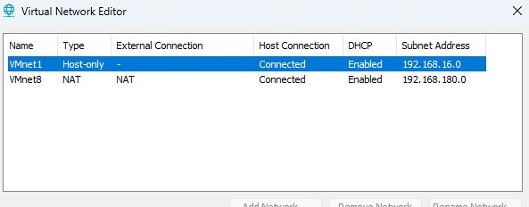

# Lab OpenStack – all-in-one (Kolla-Ansible) na VMware Workstation Pro

Cały OpenStack na **jednej VM**. Kolejność: krok 1 → 6.

---

## Krok 1. Sprawdź sieć NAT w VMware

1. VMware → **Edit → Virtual Network Editor** (kliknij *Change Settings*, jeśli trzeba uprawnień admina).
2. Wybierz **VMnet8 (NAT)** i zapisz **Subnet IP**, np. `192.168.180.0`.
3. Kliknij **NAT Settings** i zapisz **Gateway IP** (zwykle `.2`, np. `192.168.180.2`).
4. Kliknij **DHCP Settings**: DHCP rozdaje zwykle `.128–.254`. Adresów poniżej `.128` używamy statycznie.



> Tylko odczytaj wartości i zamknij okno przyciskiem **Cancel**. Zmiana bramy lub DHCP odetnie inne VM-ki w tej sieci.

Ten lab używa podsieci VMnet8 `192.168.180.0/24` i wszystkie pliki są już pod nią ustawione.
Jeśli Twoja VMnet8 ma inną podsieć, zamień `192.168.180.` we wszystkich plikach na swoją.

| Adres | Do czego |
|---|---|
| `192.168.180.2` | brama VMware NAT |
| `192.168.180.10` | VM z OpenStackiem (Horizon, API) |
| `192.168.180.51–55` | **zajęte** – węzły k3s (Kubernetes) |
| `192.168.180.100–120` | pula floating IP dla instancji OpenStacka |
| `192.168.180.128–254` | DHCP VMware – nie używać statycznie |

> ⚠️ Jeśli w tej samej sieci VMnet8 masz inne VM-ki (np. Kubernetes), sprawdź, że nie używają
> adresów `.10` ani `.100–120` – także w pulach load balancera (MetalLB).

---

## Krok 2. Utwórz VM

**File → New Virtual Machine → Custom**

| Ustawienie | Wartość |
|---|---|
| ISO | Ubuntu Server **24.04 LTS** |
| vCPU | 8 (np. 1 procesor × 8 rdzeni; minimum 4) |
| RAM | **16 GB** (można 20–24 GB, masz 64 GB) |
| Dysk 1 | **100 GB** (system + kontenery) |
| Dysk 2 | **50 GB** (dla Cindera, czyli wolumenów); dodaj go w ustawieniach VM, zostaw nieużywany |
| Karta sieciowa 1 | **NAT (VMnet8)** – zarządzanie |
| Karta sieciowa 2 | **NAT (VMnet8)** – sieć zewnętrzna Neutrona, **bez IP** |
| Procesor | ✅ **Virtualize Intel VT-x/EPT or AMD-V/RVI** |

> Obie karty są w tej samej sieci NAT. Dzięki temu floating IP instancji (`192.168.180.100+`) będą osiągalne bezpośrednio z Windowsa (ping, SSH).

**Kolejność w kreatorze:**

1. *Custom (advanced)* → *Hardware compatibility*: domyślne.
2. *Installer disc image file (iso)*: wskaż ISO Ubuntu Server 24.04.
3. *Name*: `openstack-aio` (taką samą nazwę daj potem jako hostname w Ubuntu).
4. *Processors*: 1 × 8 rdzeni, *Memory*: 16384 MB, *Network*: NAT.
5. *Disk*: **Create a new virtual disk**, SCSI, **100 GB**, ☐ *Allocate all disk space now* (puste – plik rośnie stopniowo), **Store virtual disk as a single file**.
6. Na ostatnim ekranie **nie klikaj od razu Finish** – najpierw **Customize Hardware…**

**Customize Hardware:**

- **Processors** → zaznacz ☑ **Virtualize Intel VT-x/EPT or AMD-V/RVI** (pozostałe dwa pola puste):

  

- **Add… → Hard Disk** → SCSI → nowy dysk **50 GB**, single file, bez prealokacji (dla Cindera).
- **Add… → Network Adapter** → **NAT** (druga karta, dla floating IP).
- *Sound Card* możesz usunąć (**Remove**) – serwer jej nie potrzebuje.

> ⚠️ Sprawdź, czy na liście urządzeń jest **Hard Disk 100 GB**. Jeśli go brakuje (zależnie od wersji VMware pojawia się
> dopiero po *Finish*), dodaj go przez **Add… → Hard Disk**. Bez dysku Ubuntu się nie zainstaluje.

Docelowa lista urządzeń:

```
Memory              16 GB
Processors          8   (VT-x ☑)
Hard Disk (SCSI)    100 GB
New Hard Disk       50 GB
CD/DVD (SATA)       ubuntu-24.04-live-server-amd64.iso
Network Adapter     NAT
Network Adapter 2   NAT
```

---

## Krok 3. Instalacja Ubuntu

- Język angielski, standardowa instalacja **Ubuntu Server** (nie minimized).
- Sieć: na razie zostaw DHCP, skonfigurujemy ją w kroku 4.
- Dysk: **zaznacz tylko dysk 100 GB**. Odznacz LVM albo przy LVM **rozciągnij volume na cały dysk** (instalator domyślnie daje tylko część!).
- ✅ **Install OpenSSH server**.
- Użytkownik np. `student`.

Po instalacji zaloguj się i sprawdź:

```bash
ip -br a                          # nazwy kart, np. ens33 i ens34
lsblk                             # drugi dysk, np. sdb 50G
egrep -c '(vmx|svm)' /proc/cpuinfo  # > 0 = nested KVM działa
df -h /                           # czy / ma ~95 GB
```

Jeśli `/` jest za mały (LVM zajął połowę dysku):
```bash
sudo lvextend -r -l +100%FREE /dev/ubuntu-vg/ubuntu-lv
```

---

## Krok 4. Sieć (netplan)

Skopiuj plik `netplan-aio.yaml` z tego folderu, popraw nazwy kart i adresy, potem:

```bash
sudo cp netplan-aio.yaml /etc/netplan/50-cloud-init.yaml
sudo chmod 600 /etc/netplan/50-cloud-init.yaml
echo 'network: {config: disabled}' | sudo tee /etc/cloud/cloud.cfg.d/99-disable-network-config.cfg
sudo netplan apply
ip -br a     # ens33 = 192.168.180.10, ens34 = UP bez IP
```

Od teraz łącz się z Windowsa przez SSH (wygodniej niż konsola VMware):

```powershell
ssh student@192.168.180.10
```

Pliki z Windowsa na VM kopiujesz tak:

```powershell
scp C:\Projekty\OpenStack\*.sh C:\Projekty\OpenStack\netplan-aio.yaml student@192.168.180.10:~
```

> 💡 Teraz zrób **snapshot VM** (VM → Snapshot → Take Snapshot, „czysty Ubuntu”). Jak coś się zepsuje, wracasz w 10 sekund.

---

## Krok 5. Instalacja OpenStacka

Na VM:

```bash
sed -i 's/\r$//' *.sh       # usuwa windowsowe końce linii, na wszelki wypadek
chmod +x *.sh
nano install-aio.sh         # popraw zmienne na górze pliku (karty, IP, sieć)
./install-aio.sh
```

Trwa to **30–60 minut** (pobieranie kontenerów). Skrypt kończy się wypisaniem adresu Horizon i hasła admina.

> 💡 Po udanej instalacji zrób **drugi snapshot** („OpenStack działa”).

---

## Krok 6. Pierwsze kroki

- **Horizon (GUI):** `http://192.168.180.10`, login `admin`, hasło wypisze skrypt
  (albo: `grep keystone_admin_password /etc/kolla/passwords.yml`).
- **CLI:**
  ```bash
  source ~/kolla-venv/bin/activate
  source /etc/kolla/admin-openrc.sh
  openstack service list
  ```
- Ćwiczenia krok po kroku: **`cwiczenia.md`**.

---

## Po restarcie VM

Kontenery startują same (Docker, `restart: unless-stopped`). Daj im 2–3 minuty. Jeśli coś nie działa:

```bash
sudo docker ps --filter health=unhealthy
sudo docker ps -a --filter status=exited
```

Po twardym wyłączeniu VM baza MariaDB (Galera) czasem nie wstaje sama. Wtedy:

```bash
source ~/kolla-venv/bin/activate
kolla-ansible mariadb_recovery -i ~/all-in-one
```

> Wyłączaj VM poprawnie (`sudo poweroff`), a nie „Power Off” w VMware.

## Najczęstsze problemy

| Objaw | Przyczyna / rozwiązanie |
|---|---|
| VMware: *„Virtualized Intel VT-x/EPT is not supported”* | Hyper-V/VBS w Windows. Wyłącz „Integralność pamięci” lub ustaw `bcdedit /set hypervisorlaunchtype off` (jako admin) i zrestartuj komputer. |
| `prechecks` wywala się na interfejsie | Zła nazwa karty w `install-aio.sh` albo ens34 nie jest `UP`. |
| Instancja w stanie **ERROR** | `openstack server show <nazwa>` (pole *fault*), logi: `sudo less /var/log/kolla/nova/nova-compute.log`. |
| Nie ma pingu do floating IP | Security group bez reguły ICMP/SSH (init-runonce je dodaje do projektu admin), albo zła pula w `EXT_*`. |
| Brak miejsca | `df -h`; obrazy Dockera zajmują ~20–30 GB. |
| Chcę zacząć od nowa | Wróć do snapshotu albo: `kolla-ansible destroy -i ~/all-in-one --yes-i-really-really-mean-it` |
